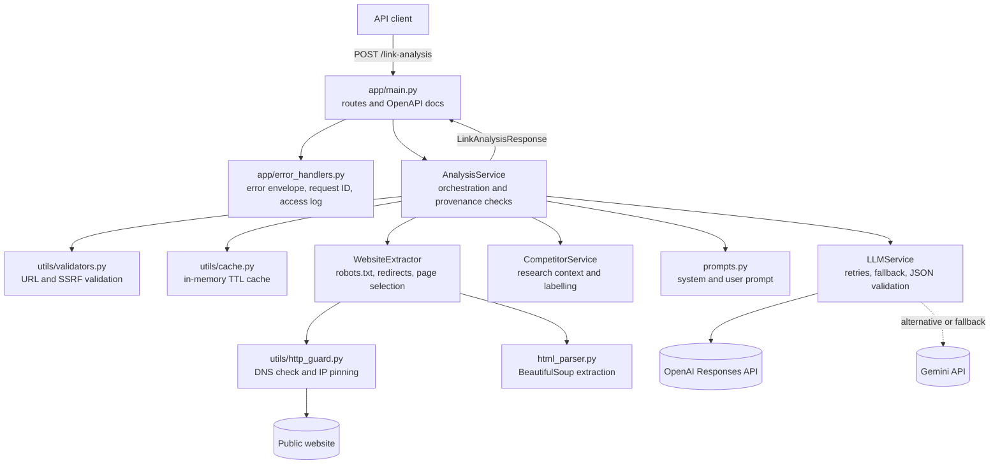

# AI-Powered Website Link Analysis API

A FastAPI service that takes a public website URL, extracts its real content, and uses an
LLM to return structured business, competitor, SEO, search-query, service and
target-audience insights.

Built as the practical assessment for Dxora Technologies.

> **Verification status.** The automated test suite (183 tests, all external HTTP and LLM
> calls mocked) passes, and the running server, URL validation, SSRF rules and live website
> extraction were checked by hand. **No real LLM analysis has been generated yet**, because
> no API key was available during development, and the Docker image has not been built or
> deployed. Details are in [Testing](#13-testing-instructions).

## Contents

1. [Project overview](#1-project-overview)
2. [Problem statement](#2-problem-statement)
3. [Features](#3-features)
4. [Technology stack](#4-technology-stack)
5. [Architecture](#5-architecture)
6. [Project structure](#6-project-structure)
7. [Installation](#7-installation-instructions)
8. [Environment setup](#8-environment-setup)
9. [Running the API](#9-api-execution-instructions)
10. [Example request](#10-example-request)
11. [Example response](#11-example-response)
12. [API documentation](#12-api-documentation-link)
13. [Testing](#13-testing-instructions)
14. [LLM provider comparison](#14-llm-provider-comparison)
15. [Cost estimation methodology](#15-cost-estimation-methodology)
16. [Final LLM recommendation](#16-final-llm-recommendation)
17. [Security considerations](#17-security-considerations)
18. [Deployment](#18-deployment-instructions)
19. [Limitations and future improvements](#19-limitations-and-future-improvements)

## 1. Project overview

`POST /link-analysis` accepts `{"url": "https://example.com"}` and returns five analysis
sections for that website:

1. Competitor vs. your brand
2. Top 5 target search queries
3. SEO improvements
4. Top 5 services
5. Target audience

The service fetches the homepage and up to four key pages (services, about, pricing and
similar), reduces the HTML to a compact text summary, and asks the configured LLM for a
JSON document that matches a strict schema. The result is validated with Pydantic before
it is returned.

## 2. Problem statement

Reviewing a company's website for positioning, SEO and audience insights is slow manual
work, and asking a general-purpose chatbot to do it produces confident answers with no
indication of what is fact and what is guesswork.

This API automates the review while keeping the two apart. Every part of the response
states where it came from:

| Label | Meaning |
| --- | --- |
| `extracted` | Stated on the website. The application checks this against the crawled text. |
| `inferred` | Reasonably implied by the website, but not stated. |
| `suggested_opportunity` | An idea for the business, not something it currently offers. |
| `ai_suggested` | A competitor named from the model's general knowledge, not verified. |
| `verified` | A competitor backed by external research evidence. |
| `ai_generated_suggestion` | Search queries and SEO recommendations. No search-volume, difficulty or ranking data is used. |

## 3. Features

**Analysis**

- All five sections in one validated JSON response.
- Provenance is enforced in code, not left to the model:
  - A service marked `extracted` is downgraded to `inferred` if its name or evidence does
    not appear in the crawled content.
  - Competitors are marked `verified` only when an external research provider supplies
    evidence. None is bundled, so competitors are currently always `ai_suggested`, with a
    `research_note` saying further research is required.
  - The schema has no fields for search volume, keyword difficulty or rankings, so the
    model cannot return them.
- `warnings` and `missing_information` lists report thin content, truncated content,
  unverified competitors and anything the website does not say.

**Website extraction**

- Title, meta description and keywords, H1–H3 headings, main text, navigation links,
  internal URLs, product and service candidates, public contact details, social profiles,
  image alt text and schema.org JSON-LD.
- Scripts, styles, navigation, footers, forms and cookie banners are removed; lines
  repeated across pages are de-duplicated; the result is capped at a character budget.
- `robots.txt` is always respected, and requests carry a descriptive `User-Agent`.

**LLM integration**

- OpenAI is the primary provider; Gemini is a drop-in alternative selected with
  `LLM_PROVIDER`. Only the selected provider needs an API key.
- Optional automatic fallback to the other provider (`LLM_FALLBACK_PROVIDER`).
- Native structured output (JSON Schema) on both providers, then Pydantic validation.
- Retries with exponential backoff for rate limits, 5xx responses and malformed output.

**Operations**

- SSRF protection with DNS validation and IP pinning (see [Security](#17-security-considerations)).
- Consistent error envelope with a request ID; no stack traces or secrets in responses.
- Structured JSON logs, in-memory result cache, health check, Dockerfile.

## 4. Technology stack

| Purpose | Technology |
| --- | --- |
| Language | Python 3.11+ (developed and tested on 3.12) |
| Web framework | FastAPI, Uvicorn |
| Validation and settings | Pydantic v2, pydantic-settings, python-dotenv |
| HTTP client | HTTPX (async), used for both website fetching and LLM calls |
| HTML parsing | BeautifulSoup4 (`html.parser`) |
| LLM providers | OpenAI Responses API (primary), Gemini `generateContent` (alternative) |
| Tests | pytest with `httpx.MockTransport` |

The LLM providers are called over REST with HTTPX rather than through their SDKs. This
keeps the dependency list short and makes every provider call mockable in tests.

## 5. Architecture



Request flow:

1. **Validate.** The URL is parsed and checked against the SSRF rules. Nothing is fetched
   for an invalid or prohibited URL.
2. **Check configuration.** If the selected provider has no API key the request fails
   with `503` before any crawling happens.
3. **Cache lookup.** Results are cached per provider, model and normalised URL.
4. **Extract.** `robots.txt` is read, the homepage is fetched, the most relevant internal
   pages are selected and fetched, and everything is reduced to a text summary.
5. **Research.** `CompetitorService` asks its research provider for external evidence.
   The bundled provider returns none, and the prompt tells the model so.
6. **Generate.** The system prompt, website summary and JSON Schema are sent to the LLM.
7. **Validate and label.** The JSON is validated, provenance labels are applied or
   corrected, and metadata and warnings are attached.

## 6. Project structure

```text
ai-link-analysis/
├── app/
│   ├── main.py                  # App factory, routes, OpenAPI documentation
│   ├── config.py                # Settings from environment variables and .env
│   ├── schemas.py               # Request, LLM draft and response models
│   ├── prompts.py               # System prompt and user prompt builder
│   ├── dependencies.py          # Service wiring for dependency injection
│   ├── error_handlers.py        # Error envelope and request-context middleware
│   ├── exceptions.py            # Application errors with HTTP status and code
│   ├── logging_config.py        # JSON and text log formatting
│   ├── examples.py              # Illustrative payloads for the API docs
│   ├── services/
│   │   ├── website_extractor.py # Safe fetching, robots.txt, page selection
│   │   ├── html_parser.py       # HTML to structured content
│   │   ├── llm_service.py       # OpenAI and Gemini providers, retries, fallback
│   │   ├── analysis_service.py  # Orchestration and provenance checks
│   │   └── competitor_service.py# Competitor research context and labelling
│   └── utils/
│       ├── validators.py        # URL validation and IP classification
│       ├── http_guard.py        # SSRF-guarding HTTPX transport
│       └── cache.py             # TTL and LRU cache
├── tests/
│   ├── conftest.py              # Fake website, fake LLM, fixtures
│   └── test_link_analysis.py    # Test suite
├── .env.example
├── .gitignore
├── .dockerignore
├── Dockerfile
├── render.yaml                  # Render Blueprint (not yet deployed)
├── pytest.ini
├── requirements.txt
└── README.md
```

## 7. Installation instructions

Requires Python 3.11 or newer.

```bash
git clone <your-repository-url>
cd ai-link-analysis

python -m venv .venv
source .venv/bin/activate          # Windows PowerShell: .\.venv\Scripts\Activate.ps1

pip install -r requirements.txt
```

## 8. Environment setup

Copy the example file and add the key for the provider you want to use:

```bash
cp .env.example .env               # Windows PowerShell: Copy-Item .env.example .env
```

```dotenv
LLM_PROVIDER=openai
OPENAI_API_KEY=sk-...
OPENAI_MODEL=
GEMINI_API_KEY=
GEMINI_MODEL=
```

Only the provider named in `LLM_PROVIDER` needs a key. Empty values fall back to the
defaults. `.env` is listed in `.gitignore` and must never be committed.

| Variable | Default | Purpose |
| --- | --- | --- |
| `LLM_PROVIDER` | `openai` | `openai` or `gemini` |
| `OPENAI_API_KEY` | none | Required when the provider is `openai` |
| `OPENAI_MODEL` | `gpt-6.1-terra` | OpenAI model |
| `GEMINI_API_KEY` | none | Required when the provider is `gemini` |
| `GEMINI_MODEL` | `gemini-4-hydrogen` | Gemini model |
| `LLM_FALLBACK_PROVIDER` | none | Second provider to try if the first fails; needs its own key |
| `OPENAI_REASONING_EFFORT` | none | Passed to OpenAI reasoning models when set |
| `LLM_TIMEOUT_SECONDS` | `90` | Timeout per LLM attempt |
| `LLM_MAX_RETRIES` | `2` | Retries after the first attempt |
| `LLM_MAX_OUTPUT_TOKENS` | `8000` | Output token cap |
| `PORT` | `4000` | Listening port; set automatically by most hosting platforms |
| `HOST` | `0.0.0.0` | Listening address |
| `LOG_LEVEL` | `INFO` | Log level |
| `LOG_FORMAT` | `json` | `json` for production, `text` for local reading |
| `MAX_PAGES` | `5` | Pages fetched per analysis, including the homepage |
| `MAX_CONTENT_CHARS` | `24000` | Character budget for page text sent to the LLM |
| `FETCH_TIMEOUT_SECONDS` | `10` | Timeout per page |
| `FETCH_TOTAL_TIMEOUT_SECONDS` | `30` | Time limit for the whole crawl |
| `ALLOWED_PORTS` | `80,443` | Destination ports the fetcher may connect to |
| `CACHE_TTL_SECONDS` | `3600` | Result cache lifetime; `0` disables the cache |

## 9. API execution instructions

```bash
python -m app.main
```

or, equivalently:

```bash
uvicorn app.main:app --host 0.0.0.0 --port 4000
```

The API listens on <http://localhost:4000>.

| Method | Path | Purpose |
| --- | --- | --- |
| `GET` | `/` | Service information |
| `GET` | `/health` | Health check; also reports whether the selected provider has a key |
| `POST` | `/link-analysis` | Analyse a website |
| `GET` | `/docs` | Swagger UI |

A request crawls the website and calls the LLM, so use a generous client timeout. With the
defaults the server allows up to 30 seconds for crawling and 90 seconds per LLM attempt.

### Error responses

Every error uses the same envelope:

```json
{
  "success": false,
  "error": {
    "code": "forbidden_destination",
    "message": "The URL points to a private network address, which is not allowed."
  },
  "request_id": "3f6c1f0a9d8e4b7c8a1b2c3d4e5f6a7b"
}
```

| Status | `error.code` | When |
| --- | --- | --- |
| 400 | `invalid_url` | Malformed URL, missing or unsupported scheme, embedded credentials |
| 403 | `forbidden_destination` | Localhost, private, reserved or metadata address; disallowed port |
| 403 | `robots_disallowed` | The website's `robots.txt` disallows the page |
| 422 | `invalid_request` | Missing or malformed request body |
| 500 | `internal_error` | Unexpected error; details are logged, not returned |
| 502 | `website_fetch_failed` | Website unreachable, HTTP error, or not HTML |
| 502 | `empty_content` | The page has no usable text |
| 502 | `llm_error`, `llm_rate_limited`, `llm_invalid_response` | The LLM provider failed, or returned output that failed validation |
| 503 | `llm_not_configured` | The selected provider has no API key |
| 504 | `website_timeout`, `llm_timeout` | The website or the LLM provider timed out |

`503` is an addition to the status codes in the brief. A missing server-side API key is a
configuration problem rather than an upstream failure, and the distinct code makes that
obvious to whoever is deploying the service.

## 10. Example request

```bash
curl -X POST http://localhost:4000/link-analysis \
  -H "Content-Type: application/json" \
  -d '{"url": "https://example.com"}'
```

PowerShell:

```powershell
Invoke-RestMethod -Method Post -Uri http://localhost:4000/link-analysis `
  -ContentType "application/json" -Body '{"url": "https://example.com"}'
```

## 11. Example response

> This example is **illustrative**. It was written by hand to show the response shape for
> a fictional business. It is not captured LLM output, and lists are shortened. The full
> version is shown in Swagger UI.

```json
{
  "success": true,
  "website": "https://www.brightleaf-accounting.example",
  "brand": {
    "name": "BrightLeaf Accounting",
    "category": "Accounting and bookkeeping services for small businesses",
    "summary": "BrightLeaf Accounting provides online bookkeeping, payroll and tax return services to freelancers and small businesses on fixed monthly plans."
  },
  "analysis": {
    "competitor_analysis": {
      "brand_name": "BrightLeaf Accounting",
      "brand_overview": "An online accounting practice offering bookkeeping, payroll and tax returns for a fixed monthly fee.",
      "business_category": "Accounting and bookkeeping services for small businesses",
      "main_products_services": ["Bookkeeping", "Payroll", "Self-assessment tax returns"],
      "verified_information": ["Pricing is presented as fixed monthly plans."],
      "competitors": [
        {
          "name": "Example Ledger Co",
          "relevance": "Targets the same freelancer and small-business audience.",
          "strengths": ["Widely recognised brand in online accounting"],
          "weaknesses_or_gaps": ["Less emphasis on a dedicated named accountant"],
          "source_classification": "ai_suggested"
        }
      ],
      "strengths": ["Fixed monthly pricing is stated up front."],
      "opportunities": ["Position as the all-in-one fixed-fee option for first-time freelancers."],
      "inferred_insights": ["The plan structure suggests a focus on price-sensitive sole traders."],
      "research_status": "ai_suggested_unverified",
      "research_note": "No external competitor research was performed. The competitors listed are AI-generated suggestions ... Further competitor research is required before relying on them."
    },
    "target_search_queries": [
      {
        "query": "online accountant for freelancers",
        "recommended_platforms": ["Google", "LinkedIn"],
        "search_intent": "commercial",
        "business_relevance": "Matches the core fixed-fee offer for freelancers.",
        "target_audience": "Freelancers choosing their first accountant",
        "data_source": "ai_generated_suggestion"
      }
    ],
    "seo_improvements": {
      "primary_keyword": "online accountant for small business",
      "secondary_keywords": ["fixed fee bookkeeping", "small business payroll service"],
      "long_tail_keywords": ["fixed monthly fee accountant for freelancers"],
      "business_keywords": ["bookkeeping", "payroll", "tax returns"],
      "recommended_title": "Online Accountant for Small Business | BrightLeaf Accounting",
      "title_explanation": "Leads with the primary keyword and ends with the brand.",
      "meta_description": "BrightLeaf Accounting handles bookkeeping, payroll and tax returns for freelancers and small businesses on simple fixed monthly plans.",
      "meta_description_business_summary": "Fixed-fee online accounting for freelancers and small businesses.",
      "meta_description_keywords": ["bookkeeping", "payroll", "tax returns"],
      "supporting_content": [
        {
          "content_type": "service_landing_page",
          "title": "Fixed-Fee Bookkeeping for Small Businesses",
          "description": "Dedicated page explaining what the bookkeeping plan covers.",
          "target_keyword": "fixed fee bookkeeping"
        }
      ],
      "current_title": "BrightLeaf Accounting",
      "current_meta_description": null,
      "data_source": "ai_generated_suggestion"
    },
    "top_services": [
      {
        "name": "Bookkeeping",
        "description": "Ongoing recording and reconciliation of business transactions.",
        "target_industry": "Small businesses across sectors",
        "target_customer": "Freelancers and small-business owners",
        "customer_benefit": "Accurate books without doing the work in-house.",
        "source_classification": "extracted",
        "evidence": "Monthly bookkeeping"
      }
    ],
    "target_audience": {
      "primary_audience": ["Freelancers and sole traders"],
      "secondary_audience": ["Small limited companies with a few employees"],
      "industries": ["Professional services", "Creative services"],
      "business_types": ["Sole traders", "Micro-businesses"],
      "customer_profiles": ["A newly self-employed designer who wants tax handled for a predictable fee."],
      "geographic_focus": [],
      "customer_needs": ["Predictable accounting costs", "Timely tax filing"],
      "customer_challenges": ["Limited time for bookkeeping", "Unfamiliar tax rules"],
      "potential_interests": ["Invoicing tools", "Cash-flow management"],
      "marketing_segments": ["Freelancers in their first year of trading"]
    }
  },
  "warnings": [
    "Competitors are AI-generated suggestions and have not been verified by external research."
  ],
  "missing_information": ["The website does not state which geographic area is served."],
  "metadata": {
    "analysis_timestamp": "2026-11-19T09:30:00Z",
    "llm_provider": "openai",
    "llm_model": "gpt-6.1-terra",
    "token_usage": {"input_tokens": 6120, "output_tokens": 3480},
    "processing_time_ms": 18450,
    "cached": false,
    "extraction_metadata": {
      "final_url": "https://www.brightleaf-accounting.example/",
      "pages_analyzed": ["https://www.brightleaf-accounting.example/"],
      "content_characters": 9840,
      "content_truncated": false,
      "robots_txt_respected": true,
      "social_links": [],
      "contact_details": {"emails": [], "phones": [], "addresses": []}
    },
    "source_classification": {"analysis.target_search_queries": "AI-generated keyword suggestions. No search-volume, keyword-difficulty or ranking data was used."}
  }
}
```

The fields required by the brief (`brand`, `competitor_analysis.brand_overview`,
`competitors`, `strengths`, `opportunities`, and so on) are all present under the same
names. The extra fields add provenance and metadata.

## 12. API documentation link

With the server running:

- Swagger UI: <http://localhost:4000/docs>
- ReDoc: <http://localhost:4000/redoc>
- OpenAPI schema: <http://localhost:4000/openapi.json>

## 13. Testing instructions

```bash
python -m pytest
```

The suite has 183 tests and needs no network access or API key. Websites are served by an
`httpx.MockTransport`, DNS by a fake resolver, and both LLM providers by mocked HTTP
responses.

| Area | Covered |
| --- | --- |
| URL validation | Valid and invalid URLs, localhost, private and reserved IPs, metadata endpoints, encoded and IPv6 forms, ports |
| SSRF | DNS records resolving to private addresses, IP pinning, redirect revalidation |
| Extraction | HTML extraction, noise removal, missing metadata, empty content, non-HTML, oversized pages, page selection, de-duplication, content budget |
| Website failures | Timeouts (504), HTTP errors (502), connection errors, `robots.txt` rules |
| LLM | Response validation, malformed JSON, missing sections, invalid values, strict schema, retries, rate limits, 5xx, timeouts, invalid key, provider selection and fallback |
| Configuration | Missing API credentials (503, without crawling), environment parsing |
| API | Successful response with all five sections, error envelope for 400, 403, 422, 500, 502, 503 and 504, request IDs, `/`, `/health`, `/docs` |

### What has and has not been verified

Verified on 19 November 2026:

- `python -m pytest`: 183 passed.
- Server started with Uvicorn; `GET /`, `GET /health`, `/docs` and `/openapi.json` returned
  200.
- `POST /link-analysis` returned the expected 400, 403 and 422 responses for invalid,
  localhost, private-IP, metadata-endpoint and malformed requests, and 503 when no API key
  was set.
- The real extractor was run against five public websites and returned titles, headings,
  navigation, social links and page text.
- A request with a deliberately invalid OpenAI key reached the real OpenAI endpoint and was
  mapped to `502 llm_error` with a message that does not contain the key.

Not verified:

- **A successful analysis from a real LLM.** No OpenAI or Gemini API key was available, so
  the request format for both providers is checked only against mocks written from the
  official API documentation. Run one real request per provider before relying on it.
- **The quality of the generated analysis**, for the same reason.
- **The Docker image and any cloud deployment** (see [Deployment](#18-deployment-instructions)).

`pytest` prints one deprecation warning from Starlette's test client suggesting `httpx2`.
It does not affect the results; this project uses HTTPX as required by the brief.

## 14. LLM provider comparison

Prices, limits and features below were read from the providers' official pages on
**19 November 2026**. They change often, so check the linked sources before relying on
them. The cost column is an **estimate** calculated with the method in the next section.
**No benchmarks were run for this project**: the speed and accuracy columns describe what
to expect and what to check, and are not measurements.

OpenAI and Gemini are implemented. Claude is included for comparison only; it would need a
new provider class in `llm_service.py`.

| | OpenAI | Google Gemini | Anthropic Claude |
| --- | --- | --- | --- |
| Recommended model | `gpt-6.1-terra` | `gemini-4-hydrogen` | `claude-sonnet-5-5` |
| Input price (per 1M tokens) | $1.00 | $1.50 | $2.00 |
| Output price (per 1M tokens) | $5.00 | $7.50 | $10.00 |
| Context window | About 1.05M tokens; up to 128K output | About 1M tokens; about 64K output | About 1M tokens; up to 128K output |
| Structured JSON support | Yes. Structured Outputs with a strict JSON Schema | Yes. `responseJsonSchema` with a JSON Schema subset | Yes. Structured outputs through `output_config.format` |
| Expected speed | Not measured. Mid-tier model in its family | Not measured. Mid-tier model in its family | Not measured. Anthropic labels this model "Fast" |
| Accuracy considerations | Strict schema adherence removes most formatting failures. Factual accuracy on competitors is not guaranteed | Supports a subset of JSON Schema, so the application re-validates. Same caveat on competitors | Its tokenizer can produce noticeably more tokens for the same text, which raises real cost. Same caveat on competitors |
| Estimated cost per analysis | $0.028 | $0.042 | $0.056 |
| Best use case | Default for this API: lowest price of the three with strict structured output | Alternative or fallback provider; a free tier exists for experimentation | Teams already using Claude, or when its writing style is preferred |
| Status in this project | Implemented (primary) | Implemented (alternative, fallback) | Not implemented |

Other tiers, for reference (same assumptions):

| Provider | Model | Input / output per 1M tokens | Estimated cost per analysis |
| --- | --- | --- | --- |
| OpenAI | `gpt-6.2-sol` | $2.00 / $10.00 | $0.056 |
| OpenAI | `gpt-6-luna` | $0.10 / $0.50 | $0.0028 |
| Gemini | `gemini-3.8-flash` | $0.75 / $3.75 until 31 Dec 2026, then $1.50 / $7.50 | $0.021 at the current price |
| Gemini | `gemini-3.5-flash-lite` | $0.30 / $2.50 | $0.0124 |
| Claude | `claude-haiku-5-5` | $0.10 / $0.50 for prompts up to 100K tokens | $0.0028 |
| Claude | `claude-opus-5-5` | $4.00 / $20.00 | $0.112 |

Notes:

- Gemini's free tier uses submitted data to improve Google's products, according to its
  pricing page. Use the paid tier for anything confidential.
- Google now recommends its Interactions API for new projects. This project uses
  `generateContent`, which Google documents as still fully supported.

Sources:

- OpenAI: [pricing](https://platform.openai.com/docs/pricing),
  [models](https://platform.openai.com/docs/models),
  [gpt-6.1-terra](https://platform.openai.com/docs/models/gpt-6.1-terra),
  [structured outputs](https://platform.openai.com/docs/guides/structured-outputs)
- Gemini: [pricing](https://ai.google.dev/gemini-api/docs/pricing),
  [models](https://ai.google.dev/gemini-api/docs/models),
  [structured output](https://ai.google.dev/gemini-api/docs/structured-output),
  [generateContent reference](https://ai.google.dev/api/generate-content)
- Claude: [pricing](https://platform.claude.com/docs/en/about-claude/pricing),
  [models](https://platform.claude.com/docs/en/about-claude/models/overview),
  [structured outputs](https://platform.claude.com/docs/en/build-with-claude/structured-outputs)

## 15. Cost estimation methodology

```text
input cost  = (input tokens  / 1,000,000) × input price
output cost = (output tokens / 1,000,000) × output price
total cost  = input cost + output cost
```

The estimates above assume **8,000 input tokens and 4,000 output tokens** per analysis.

**Where the input figure comes from.** The prompt was built for five real websites and its
size measured in characters, then converted at roughly four characters per token. That
conversion is an approximation, not a tokenizer count, and it varies by provider.

| Part of the prompt | Measured size | Approximate tokens |
| --- | --- | --- |
| System prompt | 4,701 characters | 1,200 |
| JSON Schema | 8,346 characters | 2,100 |
| Website summary, small site | 716 characters | 200 |
| Website summary, medium site | 9,500 to 12,300 characters | 2,400 to 3,100 |
| Website summary, at the content budget | about 30,000 characters | 7,500 |

That gives roughly 3,400 input tokens for a one-page site, 5,600 to 6,300 for a typical
business site and about 10,900 at the cap. 8,000 is a deliberately conservative middle
value. It assumes the schema is billed as input, which is the conservative reading.

**Where the output figure comes from.** It is an assumption. No real LLM response was
generated, so output size has not been measured. The application caps output at 8,000
tokens. Reasoning or thinking tokens are billed as output on models that use them, so
real output usage can be higher than the visible JSON suggests.

Worked example for `gpt-6.1-terra`:

```text
input cost  = (8,000 / 1,000,000) × $1.00 = $0.008
output cost = (4,000 / 1,000,000) × $5.00 = $0.020
total cost  = $0.028
```

Upper bound for the same model, with 11,000 input tokens and the full 8,000 output tokens:
$0.011 + $0.040 = **$0.051**.

Every response reports the provider's actual token counts in `metadata.token_usage`, so
these estimates can be replaced with real numbers after the first live requests.

### How the application keeps cost down

| Technique | Implementation |
| --- | --- |
| Clean the HTML | Scripts, styles, navigation, footers, forms and banners are removed before anything is sent |
| Remove duplicate content | Lines repeated across pages are sent once |
| Limit pages | Homepage plus at most four prioritised pages (`MAX_PAGES`) |
| Limit prompt length | Page text is capped at `MAX_CONTENT_CHARS`; headings, links and alt text are capped separately |
| Use a smaller model | `OPENAI_MODEL` and `GEMINI_MODEL` are configuration, with no code change needed |
| Cache results | Repeated requests for the same URL, provider and model are served from memory (`CACHE_TTL_SECONDS`) |
| Avoid redundant calls | One LLM call produces all five sections; retries happen only for transient failures |
| Limit output | `LLM_MAX_OUTPUT_TOKENS`, and schema limits of five queries, services and competitors |
| Fail early | Invalid URLs and missing API keys are rejected before any crawl or LLM call |

## 16. Final LLM recommendation

**Use OpenAI `gpt-6.1-terra` as the default, with `gemini-4-hydrogen` configured as the
fallback.**

- It is the cheapest of the three recommended models at an estimated $0.028 per analysis.
- Strict Structured Outputs guarantee the response matches the schema, which matters more
  here than raw capability because the output is a large nested JSON document.
- Its context window is far larger than this workload needs, so the content budget, not
  the model, is the limit.

For high volume, `gpt-6-luna` or `claude-haiku-5-5` would cost about a tenth as much. The
risk is weaker judgement on the parts that need it, such as separating stated services
from inferred ones and choosing plausible competitors.

This recommendation is based on published prices and documented features. It has not been
confirmed by running the models side by side. Before committing, run the same 10 to 20
websites through each candidate and compare the outputs and the `token_usage` figures.

## 17. Security considerations

**SSRF protection**

- Only `http` and `https` URLs are accepted, on ports 80 and 443 by default.
- URLs with embedded credentials, control characters or backslashes are rejected.
- Hostnames are normalised (IDNA and Unicode folding) before checks, and non-standard IP
  notations such as decimal or hexadecimal integers are rejected.
- Localhost, `.local`, `.internal` and similar names are blocked.
- Loopback, private, link-local, carrier-grade NAT, multicast, reserved and unspecified
  addresses are blocked for IPv4 and IPv6, including IPv4-mapped, 6to4, Teredo and NAT64
  forms that embed an IPv4 address.
- Cloud metadata endpoints are blocked explicitly (`169.254.169.254`, `169.254.170.2`,
  `100.100.100.200`, `192.0.0.192`, `fd00:ec2::254`).
- **DNS validation.** Every address a hostname resolves to must be public, or the request
  is refused.
- **DNS rebinding.** The connection is made to the exact IP address that was validated,
  with the original `Host` header and TLS server name. The hostname is not resolved a
  second time, so a DNS answer cannot change between the check and the connection.
- **Redirects** are followed manually, at most five, and each hop goes through the same
  validation.
- Proxy environment variables are ignored and connections are not reused between hosts.

**Respecting websites**

- `robots.txt` is always honoured; there is no switch to turn this off. If it returns 401,
  403 or a server error, the site is treated as disallowing access.
- The fetcher identifies itself with a descriptive `User-Agent`, makes at most five page
  requests per analysis with two in parallel, and makes no attempt to get around
  bot protection, logins or paywalls.
- Responses are capped at 2 MB and must be HTML.

**Secrets**

- API keys are read only from the environment or `.env`, stored as `SecretStr`, and sent
  only in request headers to the provider.
- Keys are redacted from provider error messages before logging. A test asserts that an
  invalid key never appears in the response or the logs.
- `.env` is excluded by `.gitignore` and `.dockerignore`.

**Responses and logs**

- Clients never receive stack traces or internal exception messages. Unexpected errors
  return a generic `500` with a request ID that matches the server log.
- Website content is treated as untrusted data in the prompt. It is wrapped in a delimited
  block, the delimiter is neutralised if it appears in the content, and the system prompt
  tells the model to ignore instructions inside it. This reduces prompt-injection risk but
  cannot eliminate it.

**Not included**

- Authentication and rate limiting. The endpoint spends money on every uncached call, so
  add an API key check and a rate limit, or put the service behind a gateway, before
  exposing it publicly.

## 18. Deployment instructions

> **Not deployed.** The application has not been deployed to any platform, and the Docker
> image has not been built, because Docker was not running on the development machine.
> The files below follow each platform's documented conventions but are untested.

The application listens on `0.0.0.0` and uses the `PORT` environment variable when the
platform provides one, falling back to 4000. Health checks should target `GET /health`.
Logs are single-line JSON on standard output.

### Docker

```bash
docker build -t ai-link-analysis .
docker run --rm -p 4000:4000 --env-file .env ai-link-analysis
```

The image runs as a non-root user and includes a `HEALTHCHECK`.

### Render

1. Push the repository to GitHub.
2. In Render, choose **New > Blueprint** and select the repository. `render.yaml` defines a
   Docker web service with `/health` as the health check.
3. Enter `OPENAI_API_KEY` (or `GEMINI_API_KEY` and `LLM_PROVIDER=gemini`) when prompted.

Without the Blueprint, create a **Web Service** with the Docker runtime, or with the
Python runtime using build command `pip install -r requirements.txt` and start command
`python -m app.main`.

### Railway

1. Create a project from the GitHub repository. Railway builds from the `Dockerfile`.
2. Add `OPENAI_API_KEY` and `LLM_PROVIDER` under **Variables**.
3. Generate a public domain under **Settings > Networking**. Railway sets `PORT` itself.

### After deploying

```bash
curl https://<your-domain>/health
curl -X POST https://<your-domain>/link-analysis \
  -H "Content-Type: application/json" -d '{"url": "https://example.com"}'
```

`/health` should report `"llm_configured": true`.

## 19. Limitations and future improvements

**Current limitations**

- **No JavaScript rendering.** Sites that build their content in the browser yield little
  text. The API reports this in `warnings`, or returns `502 empty_content`.
- **Competitors are not researched.** They come from the model's general knowledge and are
  labelled `ai_suggested`. They may be outdated, mismatched or, occasionally, not real.
- **No keyword data.** Queries and keywords are suggestions with no search volume,
  difficulty or ranking information behind them.
- **The `extracted` check is lexical.** It confirms that a service's words appear on the
  website, not that the description is accurate.
- **In-memory cache.** It is lost on restart and not shared between instances.
- **`robots.txt` `Crawl-delay` is not applied.** The crawl is limited to five requests
  instead.
- **Synchronous request.** The client waits for the whole analysis.
- **Not yet run against a real LLM**, as described under [Testing](#13-testing-instructions).

**Future improvements**

- Plug a search API into `CompetitorResearchProvider` so competitors can be verified and
  cited. The interface and the `verified` label already exist.
- Add a keyword-data provider for real search volumes.
- Optional headless-browser rendering for JavaScript-heavy sites.
- API-key authentication and per-client rate limiting.
- A shared cache such as Redis, and a background-job mode with polling for long analyses.
- A Claude provider, and migration of the Gemini provider to the Interactions API.
- A small evaluation set of websites to compare models on quality and cost.
